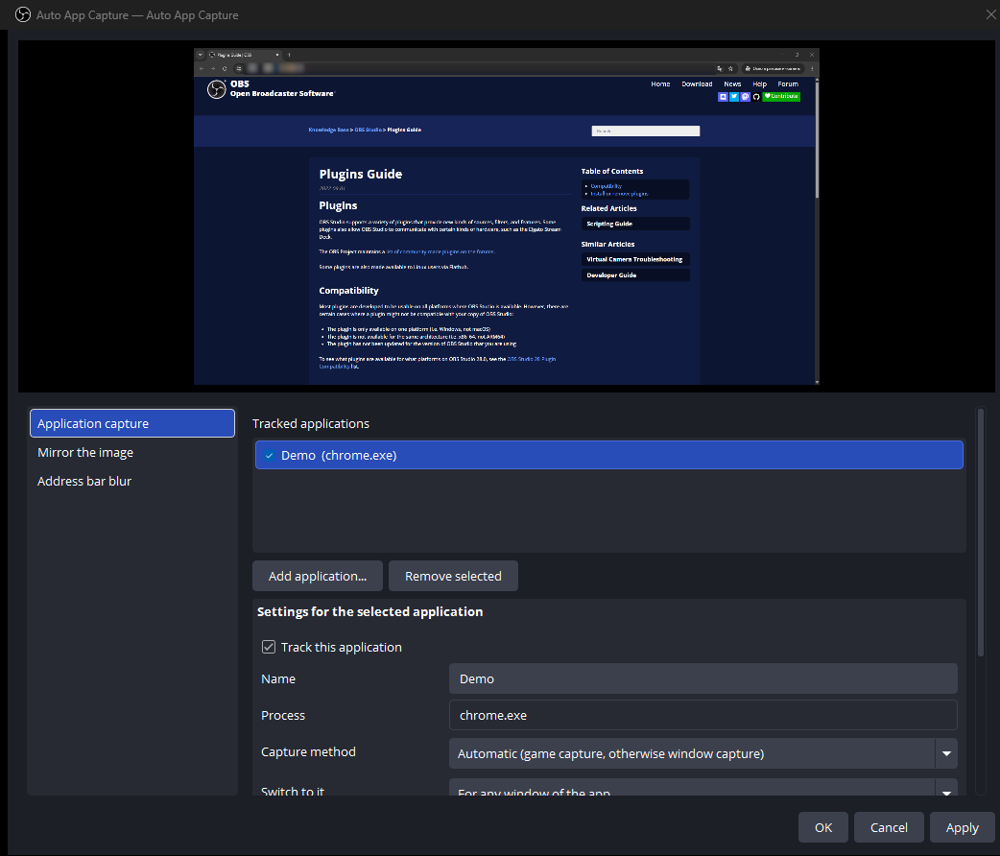
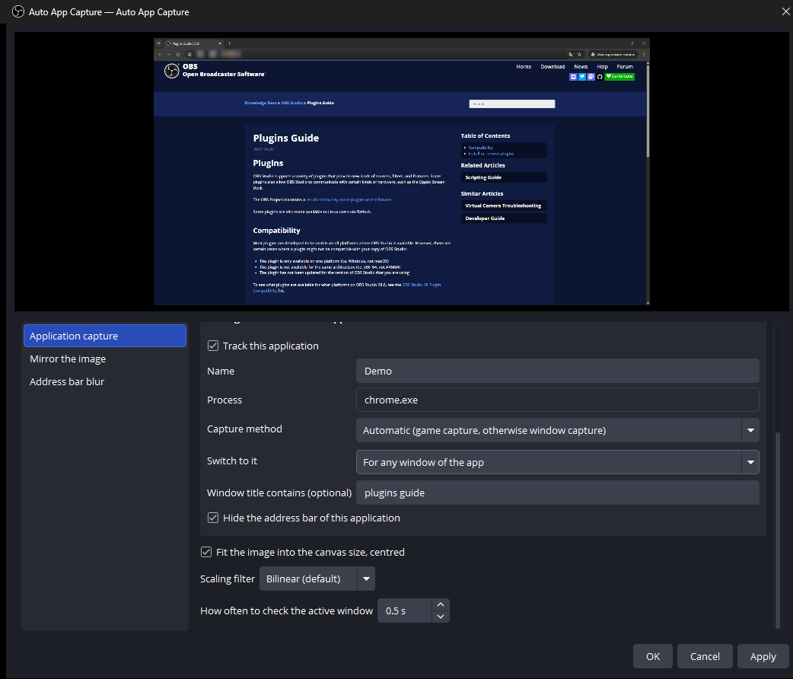
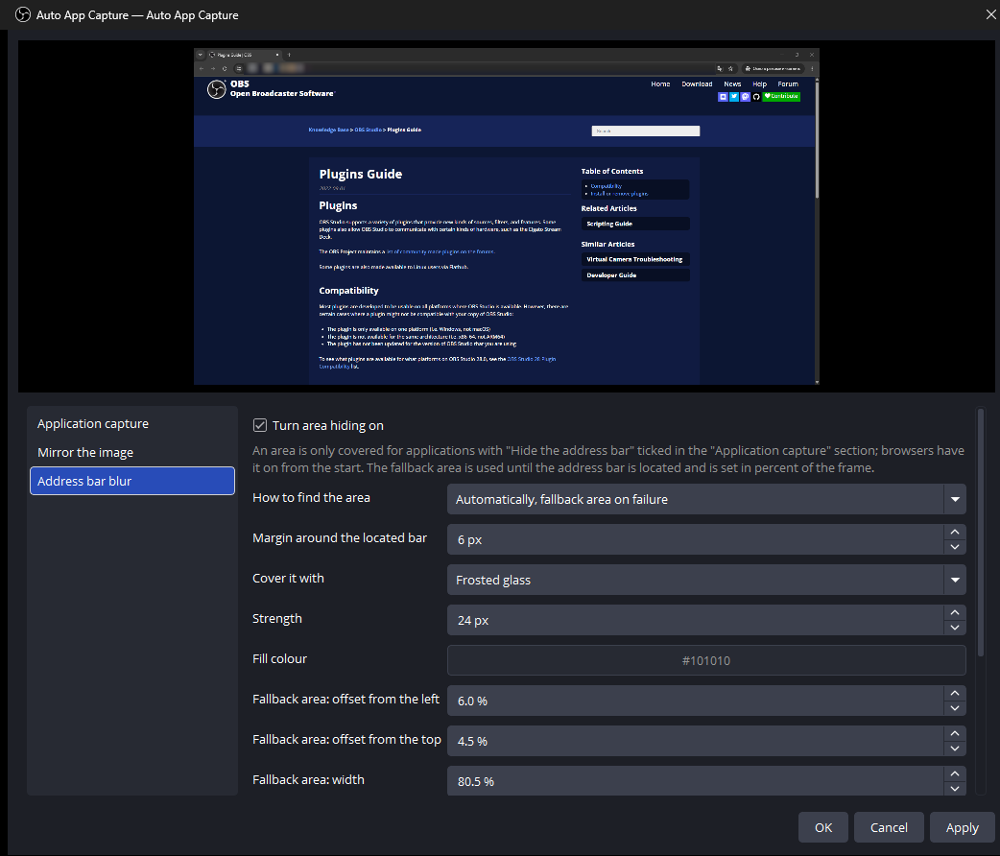
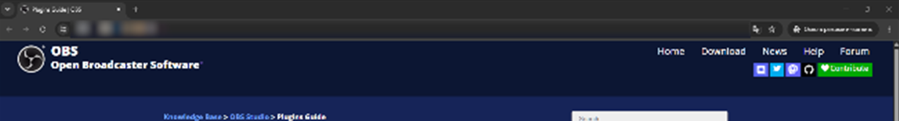

<p align="center">
  
</p>

<h1 align="center">OBS Auto Capture</h1>

<p align="center">
  <b>One source that follows whatever application you are using.</b><br>
  List your game, your browser and your chat window once.<br>
  The source switches between them on its own, keeps the frame the same size<br>
  and covers the browser address bar before it reaches the stream.
</p>

<p align="center">
  
  
  <a href="https://github.com/Dimension-Science/obs-auto-capture/releases/latest"></a>
  
  
</p>

<p align="center">
  <a href="https://github.com/Dimension-Science/obs-auto-capture/releases/latest"></a>
</p>

<p align="center">
  <b>English</b> · <a href="README.ru.md">Русский</a> ·
  <a href="https://github.com/Dimension-Science/obs-auto-capture/releases">All releases</a> ·
  <a href="docs/release-notes">Release notes</a>
</p>

<br>

<p align="center">
  
  <br>
  <sub>Everything lives in one window. The preview on top shows the frame that goes out, blur included.</sub>
</p>

> [!NOTE]
> Made with the help of AI. The plugin is a native OBS module built on libobs,
> the Win32 API and UI Automation, with no helper process and no launcher beside OBS.

<p align="center">
  <a href="#what-it-does">What it does</a> ·
  <a href="#installing">Installing</a> ·
  <a href="#the-settings-window">Settings</a> ·
  <a href="#what-the-blur-covers">Blur</a> ·
  <a href="#which-obs-versions-it-runs-on">OBS versions</a> ·
  <a href="#building">Building</a>
</p>

<br>

<table>
  <tr>
    <td width="25%" valign="top">
      <h3>🎯 Follows the foreground app</h3>
      One source, a list of executables. Alt-tab from the game to the browser and the capture goes with you. Switch to something that is not on the list and the last capture stays on screen instead of going black.
    </td>
    <td width="25%" valign="top">
      <h3>🔒 Address bar covered</h3>
      The plugin asks the browser where its address bar sits and covers it with frosted glass, pixels or a colour. Browsers get this from the start, a game never does.
    </td>
    <td width="25%" valign="top">
      <h3>📐 One size for every app</h3>
      A 640×480 game and a maximised browser arrive at the canvas the same size, centred. You stop resizing the scene item after every switch.
    </td>
    <td width="25%" valign="top">
      <h3>⚙️ Game capture when it fits</h3>
      Game capture where it works, window capture otherwise. Force either one per application when you know better.
    </td>
  </tr>
</table>

<br>

## What it does

<table>
  <tr>
    <td width="50%" valign="top">
      
      <br>
      <sub>One rule per application. The title filter keeps the source on the window you mean.</sub>
      <h3>A rule for each application</h3>
      Add an application from the list of what is running, or type the executable name. Each rule carries its own capture method, its own answer to whether any window counts or only a fullscreen one, and an optional piece of the window title.
      <br><br>
      The title filter separates a stream dashboard from your personal tabs in the same browser. A rule you untick stops the capture without losing its settings.
    </td>
    <td width="50%" valign="top">
      
      <br>
      <sub>Frosted glass over the located bar, with a fallback area for the moments before it is found.</sub>
      <h3>The address bar never reaches the stream</h3>
      UI Automation reports where Chrome, Edge or Firefox keeps its address bar, and the plugin covers that rectangle. Until the bar is located, and whenever the reading stops making sense, the fallback area takes over.
      <br><br>
      Frosted glass is a mosaic with a soft blend between cells, so the text under it is destroyed instead of smeared. No filter brings it back.
    </td>
  </tr>
  <tr>
    <td width="50%" valign="top">
      
      <br>
      <sub>The same frame at full size. The URL is gone, the page is untouched.</sub>
      <h3>Nothing else loses quality</h3>
      The cover sits on the finished frame and reaches only the rectangle it was given. Switch the tracked application and the next frame is the game, with no effect over it at all.
      <br><br>
      Fullscreen browsers are the one case with nothing to cover. Detection keeps running there, so the bar that slides in when the pointer touches the top edge is covered too.
    </td>
    <td width="50%" valign="top">
      <h3>The frame keeps its size</h3>
      Tick <b>Fit the image into the canvas size, centred</b> and the source hands OBS a frame of canvas size whatever it captured. A small game is scaled up and centred, a capture larger than the canvas is scaled down, and the scene item never changes size.
      <br><br>
      Pick the <b>scaling filter</b> next to it: bilinear for most things, point for pixel art, bicubic or Lanczos when you are shrinking. These are the scaling effects OBS ships for scene items, so the result matches what OBS would produce.
      <h3>Mirror by window title</h3>
      List a few words. While the title of the active window contains one of them, the image is flipped horizontally. Useful for the sites that show you mirrored.
    </td>
  </tr>
</table>

<br>

## Installing

Download the installer from [Releases](https://github.com/Dimension-Science/obs-auto-capture/releases)
and run it. It finds OBS on its own and offers `%ProgramData%\obs-studio\plugins`,
the folder OBS reads on Windows and the one that survives an OBS update. When it
finds a portable OBS instead, it offers that folder, because a portable copy
loads plugins from its own directory and nowhere else. The path is a suggestion:
**Browse** takes you anywhere.

Restart OBS afterwards. The source appears in **Sources → + → Auto App Capture**,
and the window that opens on a double click is the one in the picture above.

The zip on the same page is for unpacking by hand.

Windows SmartScreen warns about the installer, because the build carries no code
signing certificate. **More info → Run anyway** gets past it. The same files sit
in the zip if you would rather look at them first.

## The settings window

Add the **Auto App Capture** source to a scene and double click it. The window
opens with a live preview on top and three sections under it.

| Section | What you set there |
| --- | --- |
| Application capture | The tracked applications and the rule for the selected one, plus fit to canvas, the scaling filter and how often the active window is checked |
| Mirror the image | Words that flip the picture while they appear in the window title |
| Address bar blur | How the area is found, what covers it, how strong, and the fallback rectangle |

## What the blur covers

The blur is a privacy feature, so every failure ends with **more** covered, never
less:

- While the bar has not been located, when detection is unavailable, or when the
  captured frame stops matching the window, the fallback area is covered instead.
- A window that only looks fullscreen, such as a maximised one on a screen with
  no visible taskbar, keeps its cover. When the two cannot be told apart, the
  cover stays.
- You turn it on per application. Browsers arrive with it on, everything else
  arrives with it off, so a game is never covered by accident.

It does not cover tab titles, the link preview in the bottom-left corner, or the
suggestion list under the bar while you type. It closes one way for a URL to
reach the stream. The others are still open.

## Which OBS versions it runs on

Windows, OBS Studio 30.0 and newer, 31.x and 32.x included. One binary covers
all of them: libobs refuses a plugin built against a *newer* release than the one
running it, so the plugin is built against the oldest version it supports.

Each release runs in an isolated portable OBS before it ships, through
`tools/New-TestObs.ps1`, and the check reads the log for the source being
created rather than for the module being loaded: a module that loads has proved
only that its imports resolved. Checked that way on portable 30.2.3 and 31.1.2
and on installed 32.x.

## Building

The project uses the official OBS plugin template. You need no OBS checkout:
configuring downloads the pinned OBS sources and the prebuilt dependencies into
`.deps`.

```
cmake --preset windows-x64
cmake --build --preset windows-x64
```

Visual Studio 2022 and CMake 3.28 or newer. The first configure takes a while,
because it builds libobs.

`buildspec.json` pins the dependency versions. Two files under `cmake/` carry
local changes to the template, both marked `Local change to the vendored
template`; carry them over when you update it.

## Licence

GPL-2.0, matching libobs. See [LICENSE](LICENSE).
