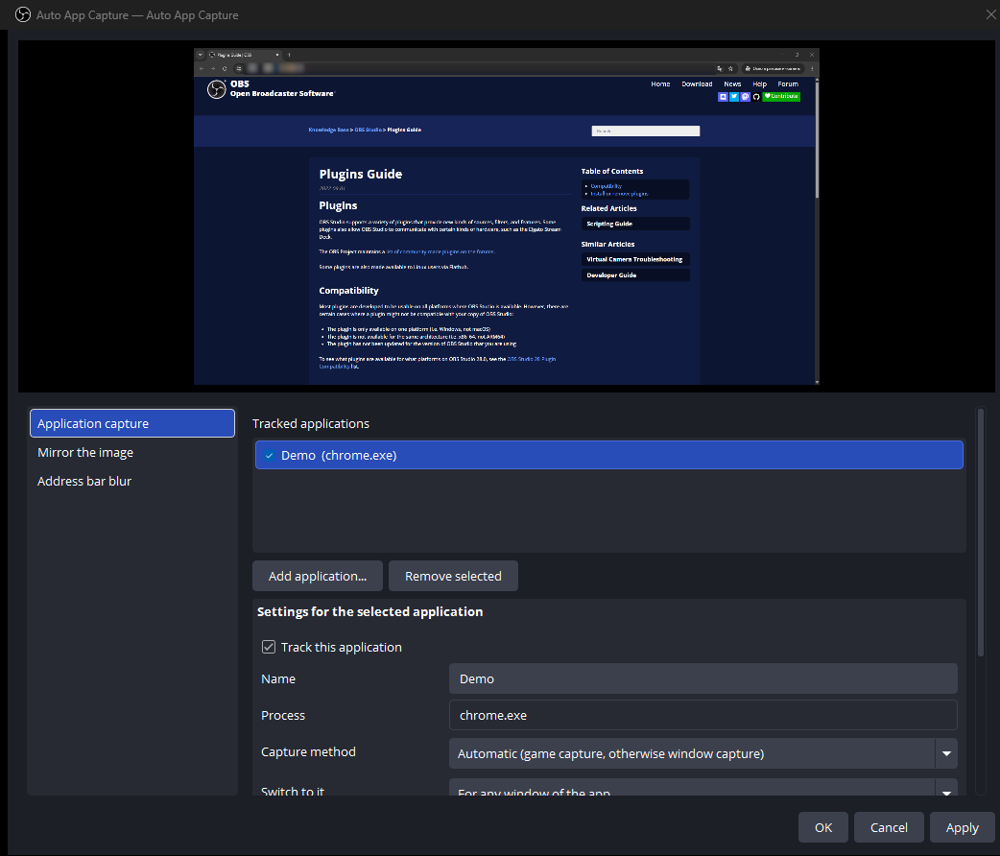
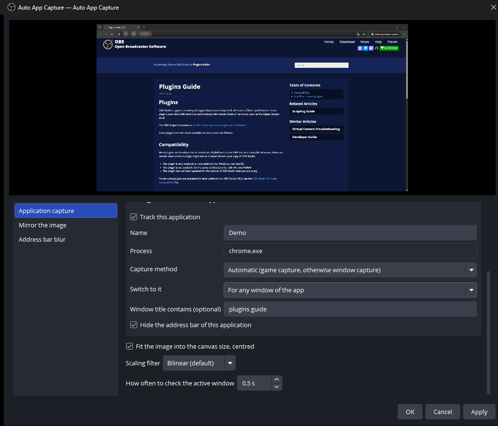
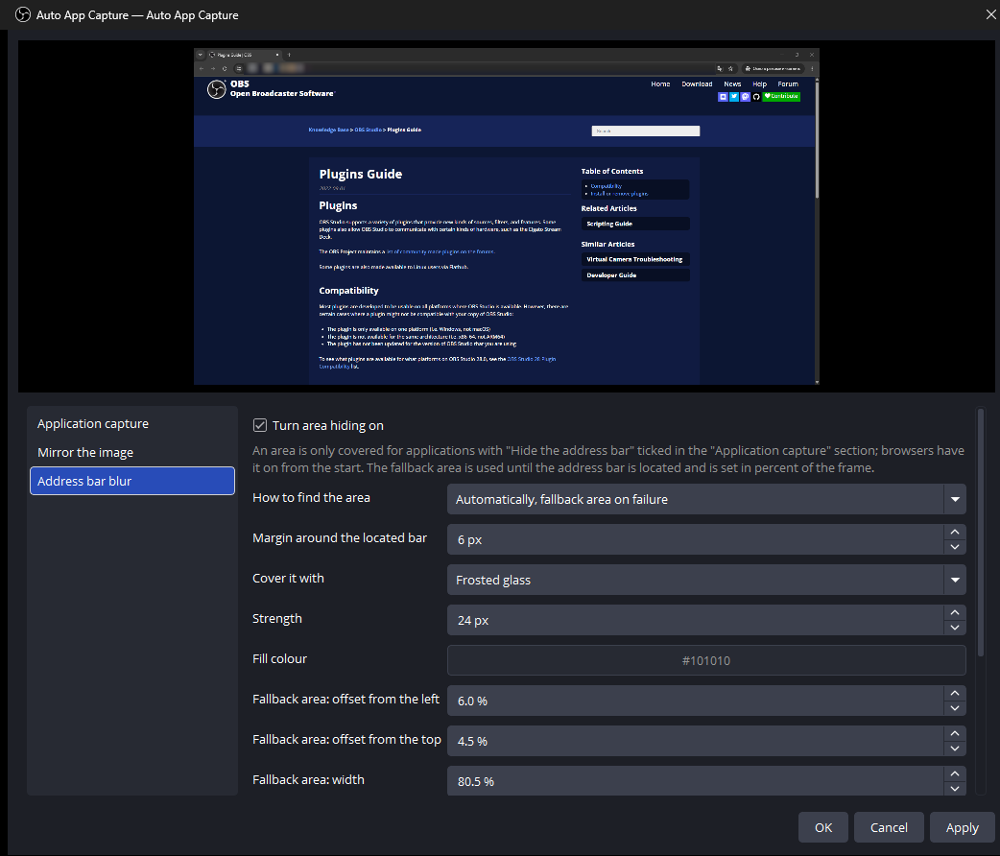
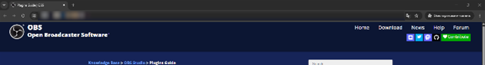

<p align="center">
  
</p>

<h1 align="center">OBS Auto Capture</h1>

<p align="center">
  <b>Один источник, который идёт за приложением, в котором вы сейчас работаете.</b><br>
  Перечислите игру, браузер и чат один раз.<br>
  Источник сам переключается между ними, держит кадр одного размера<br>
  и закрывает адресную строку браузера до того, как она уйдёт в эфир.
</p>

<p align="center">
  
  
  <a href="https://github.com/Dimension-Science/obs-auto-capture/releases/latest"></a>
  
  
</p>

<p align="center">
  <a href="https://github.com/Dimension-Science/obs-auto-capture/releases/latest"></a>
</p>

<p align="center">
  <b>Русский</b> · <a href="README.md">English</a> ·
  <a href="https://github.com/Dimension-Science/obs-auto-capture/releases">Все релизы</a> ·
  <a href="docs/release-notes">Описания версий</a>
</p>

<br>

<p align="center">
  
  <br>
  <sub>Всё в одном окне. Превью сверху показывает тот самый кадр, который уходит в эфир, вместе с блюром.<br>
  Язык интерфейса плагина идёт за языком OBS; на снимках английский.</sub>
</p>

> [!NOTE]
> Сделано с использованием AI. Это нативный модуль OBS на libobs, Win32 API и UI
> Automation: без вспомогательного процесса и без лаунчера рядом с OBS.

<p align="center">
  <a href="#что-он-делает">Что он делает</a> ·
  <a href="#установка">Установка</a> ·
  <a href="#окно-настроек">Настройки</a> ·
  <a href="#что-закрывает-блюр">Блюр</a> ·
  <a href="#на-каких-версиях-obs-работает">Версии OBS</a> ·
  <a href="#сборка">Сборка</a>
</p>

<br>

<table>
  <tr>
    <td width="25%" valign="top">
      <h3>🎯 Идёт за активным окном</h3>
      Один источник и список программ. Переключились из игры в браузер — захват переехал с вами. Перешли в то, чего в списке нет, — на экране остаётся последний захват, а не чёрный кадр.
    </td>
    <td width="25%" valign="top">
      <h3>🔒 Адресная строка закрыта</h3>
      Плагин спрашивает у браузера, где его адресная строка, и закрывает её матовым стеклом, пикселями или цветом. У браузеров это включено сразу, у игры — никогда.
    </td>
    <td width="25%" valign="top">
      <h3>📐 Один размер для всех</h3>
      Игра 640×480 и развёрнутый браузер приходят на холст одного размера, по центру. Больше не надо тянуть элемент сцены после каждого переключения.
    </td>
    <td width="25%" valign="top">
      <h3>⚙️ Захват игры, когда он подходит</h3>
      Захват игры там, где он работает, иначе захват окна. Для конкретного приложения можно задать жёстко.
    </td>
  </tr>
</table>

<br>

## Что он делает

<table>
  <tr>
    <td width="50%" valign="top">
      
      <br>
      <sub>Своё правило на каждое приложение. Фильтр по заголовку удерживает источник на нужном окне.</sub>
      <h3>Правило на каждое приложение</h3>
      Добавьте программу из списка запущенных или впишите имя exe. У правила свой способ захвата, свой ответ на вопрос «любое окно или только полноэкранное» и необязательный кусок заголовка окна.
      <br><br>
      Фильтр по заголовку отделяет рабочую панель стримера от личных вкладок в том же браузере. Снятая галочка останавливает захват, не стирая настройки правила.
    </td>
    <td width="50%" valign="top">
      
      <br>
      <sub>Матовое стекло поверх найденной строки и запасная область на то время, пока строка не найдена.</sub>
      <h3>Адрес не доезжает до эфира</h3>
      UI Automation сообщает, где Chrome, Edge или Firefox держит адресную строку, и плагин закрывает этот прямоугольник. Пока строка не найдена и как только показания перестают быть осмысленными, работает запасная область.
      <br><br>
      Матовое стекло — это мозаика с мягким переходом между ячейками: текст под ней уничтожен, а не размазан. Никакой фильтр его не вернёт.
    </td>
  </tr>
  <tr>
    <td width="50%" valign="top">
      
      <br>
      <sub>Тот же кадр в полный размер. Адреса нет, страница не тронута.</sub>
      <h3>Остальной кадр не страдает</h3>
      Закрытие ложится на готовый кадр и достаёт только до выданного прямоугольника. Переключите отслеживаемое приложение, и следующий кадр будет игрой, вообще без эффекта поверх.
      <br><br>
      Полноэкранный браузер — единственный случай, где закрывать нечего. Определение там продолжает работать, поэтому выезжающая строка, когда курсор подходит к верхнему краю, тоже закрыта.
    </td>
    <td width="50%" valign="top">
      <h3>Кадр сохраняет размер</h3>
      Поставьте галочку <b>«Вписывать изображение в размер холста по центру»</b>, и источник отдаёт OBS кадр размером с холст, что бы он ни захватил. Маленькая игра увеличивается и встаёт по центру, захват крупнее холста уменьшается, а элемент сцены не меняет размер.
      <br><br>
      Рядом выбирается <b>фильтр масштабирования</b>: билинейный для большинства случаев, точечный для пиксельной графики, бикубический или Ланцош при уменьшении. Это штатные эффекты OBS для элементов сцены, поэтому результат совпадает с тем, что сделала бы сама OBS.
      <h3>Отражение по заголовку окна</h3>
      Перечислите несколько слов. Пока заголовок активного окна содержит одно из них, изображение отражается по горизонтали. Пригодится для сайтов, которые показывают вас зеркально.
    </td>
  </tr>
</table>

<br>

## Установка

Скачайте установщик со страницы [релизов](https://github.com/Dimension-Science/obs-auto-capture/releases)
и запустите. Он сам находит OBS и предлагает `%ProgramData%\obs-studio\plugins` —
папку, откуда OBS читает плагины в Windows и которая переживает обновление OBS.
Если найдётся портативная OBS, он предложит её папку: портативная копия грузит
плагины только из своего каталога. Путь — это предложение, кнопка **Обзор**
отправит куда угодно.

После установки перезапустите OBS. Источник появится в списке
**Источники → + → Автозахват приложений**, а по двойному щелчку откроется то
самое окно с картинки выше.

Zip с той же страницы — для распаковки руками.

Windows SmartScreen ругается на установщик: у сборки нет сертификата подписи.
Пройти можно через **Подробнее → Выполнить в любом случае**. Если хочется
сначала посмотреть, что внутри, те же файлы лежат в zip.

## Окно настроек

Добавьте в сцену источник **Автозахват приложений** и щёлкните по нему дважды.
Откроется окно с живым превью сверху и тремя разделами под ним.

| Раздел | Что там настраивается |
| --- | --- |
| Захват приложений | Отслеживаемые приложения и правило для выбранного, плюс вписывание в холст, фильтр масштабирования и частота проверки активного окна |
| Отражение изображения | Слова, при которых картинка отражается, пока они есть в заголовке окна |
| Блюр адресной строки | Как ищется область, чем закрывается, насколько сильно и запасной прямоугольник |

## Что закрывает блюр

Блюр сделан ради приватности, поэтому любая неудача заканчивается тем, что
закрыто **больше**, а не меньше:

- Пока строка не найдена, когда определение недоступно и когда захваченный кадр
  перестал соответствовать окну, закрывается запасная область.
- Окно, которое только похоже на полноэкранное — например, развёрнутое на экране
  без видимой панели задач, — закрытие сохраняет. Если одно от другого не
  отличить, закрытие остаётся.
- Включается для каждого приложения отдельно. У браузеров сразу включено, у
  остальных выключено, поэтому игру не закроет по случайности.

Не закрываются: заголовки вкладок, превью ссылки в левом нижнем углу и список
подсказок под строкой во время набора. Один способ показать адрес в эфире он
закрывает, остальные остаются.

## На каких версиях OBS работает

Windows, OBS Studio 30.0 и новее, включая 31.x и 32.x. Один бинарник подходит
всем: libobs отклоняет плагин, собранный против **более новой** версии, чем
запущенная, поэтому плагин собирается против самой старой из поддерживаемых.

Каждый релиз перед выпуском запускается в изолированной портативной OBS через
`tools/New-TestObs.ps1`, и проверка ищет в логе создание источника, а не
загрузку модуля. Загрузившийся модуль доказывает только то, что разрешились
импорты. Диапазон пройден на портативных 30.2.3 и 31.1.2 и на установленной 32.x.

## Сборка

Проект собран на официальном шаблоне плагинов OBS. Исходники OBS выкачивать не
надо: конфигурация сама скачивает закреплённые версии OBS и готовые зависимости
в `.deps`.

```
cmake --preset windows-x64
cmake --build --preset windows-x64
```

Нужны Visual Studio 2022 и CMake 3.28 или новее. Первая конфигурация идёт долго,
потому что собирается libobs.

Версии зависимостей закреплены в `buildspec.json`. Два файла в `cmake/` содержат
локальные правки шаблона, обе помечены `Local change to the vendored template`:
при обновлении шаблона их надо перенести.

## Лицензия

GPL-2.0, как у libobs. См. [LICENSE](LICENSE).
